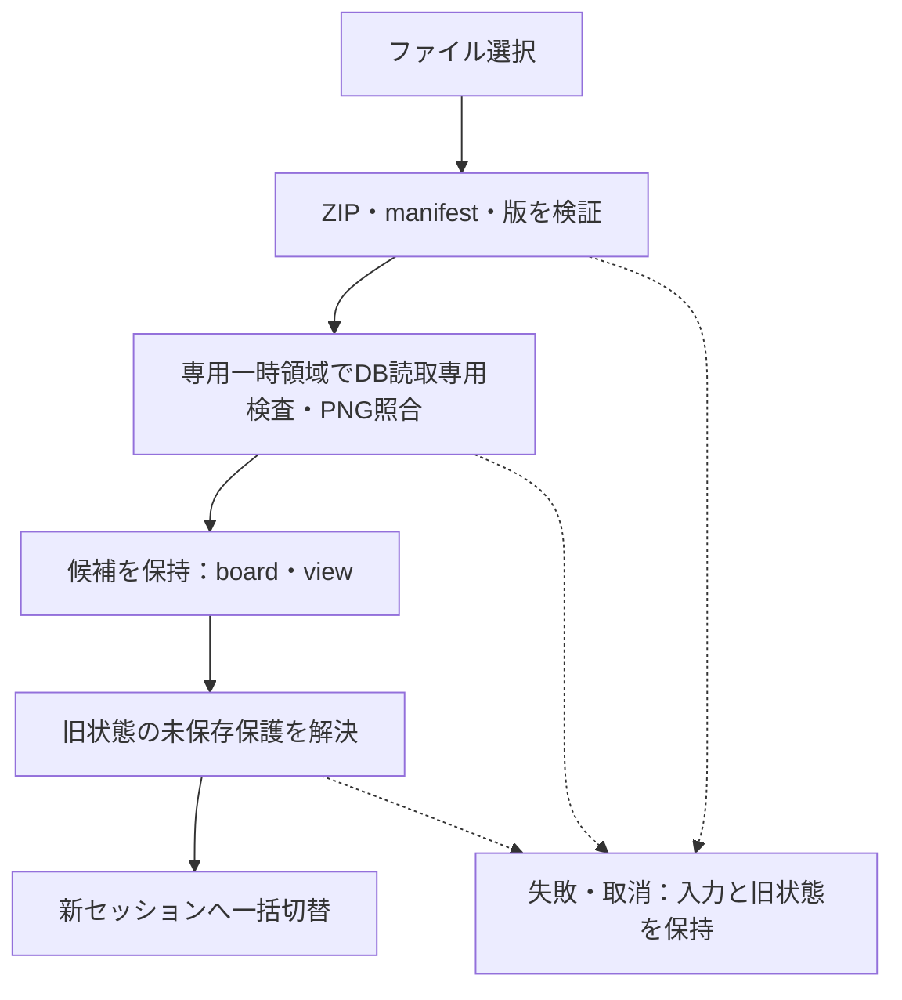

# DES-009：プロジェクトの保存・読込・復旧設計

- 設計状態：評価待ち。保存統合・復元と資源制御を具体化済み。合意済み要件との詳細照合、保存・復旧・排他の障害検証、IPCの成立、ライブラリの配布構成、保存中・再開時の性能の確認が残る。設計担当が要件・関連設計との整合を確認し、実装・検証担当が方式の成立を確認する。必要な確認後、ドラフトに戻して再レビューする。
- 目的・範囲：プロジェクト永続化の処理契約と失敗時の保護。物理構造は[DES-008](../../data-design/DES-008-project-file-data.md)、編集単位は[DES-002](../organization/DES-002-board-editing-state.md)、画面は[DES-007](../../screen-design/DES-007-persistence-screen.md)を正本とする。
- 入力確認日：2026-09-30。確認時点の入力は[DES-008](../../data-design/DES-008-project-file-data.md)、[DES-002](../organization/DES-002-board-editing-state.md)、[DES-007](../../screen-design/DES-007-persistence-screen.md)、[REQ-011～019](../../../product-requirements/functional-requirements/cross-cutting/REQ-011-restore-saved-content.md#req-011保存内容の復元)の本文・該当節。現在の合意状況・設計状態は各本文を正本とし、方式の反映と成立確認を区別する。
- 参照要件：[REQ-011～019](../../../product-requirements/functional-requirements/cross-cutting/REQ-011-restore-saved-content.md#req-011保存内容の復元)（011～017・019は今回の意味変更に伴いドラフト、018は合意済み）、[REQ-023～025](../../../product-requirements/non-functional-requirements/cross-cutting/REQ-023-saving-operation-latency.md#req-023保存中の操作反応)（条件付き合意：保存中操作と500枚再開）。変更後の受入条件と既存性能基準は要件本文を正本とする。
- 関連ADR：[ADR-011](../../architecture-decisions/2026-10-05-ADR-011-project-lock-and-retry.md)（排他・明示再試行、提案）、[ADR-004](../../architecture-decisions/2026-09-26-ADR-004-zip-board-storage.md)・[ADR-010](../../architecture-decisions/2026-09-29-ADR-010-sqlite-project-storage.md)は採用、[ADR-005](../../architecture-decisions/2026-09-26-ADR-005-save-recovery-policy.md)は変更要件レビュー・障害検証が残る提案。

## 責務と状態

TypeScriptはボード・表示中心と倍率、boardRevision・savedBoardRevision、ボードの未保存表示と要求達成待ちを所有する。Rustはボード保存キュー、直前成功内容B0、画像参照、DB・ZIP生成検証、置換・復旧・保存先を所有する。共通設定は[DES-063](DES-063-common-settings-management.md)のAppSettingsServiceへ分離し、同じアプリ配置先の全ボードに適用する。

- board/viewの確定変更でboardRevisionを進める。Undoも新番号。同値・描画・選択だけ・未確定ドラッグは進めない。パン・ズームは保存対象だがUndo対象外。選択時前面化の確定境界はDES-002。
- ボード番号はセッション内で単調増加し、採用時に現在・成功番号を0へ初期化する。フォント補正で保存属性が変わる場合だけboardRevision=1、savedBoardRevision=0。共通設定の番号は初期化しない。
- B0・履歴・進行中保存・候補の全参照がなくなるまで画像実体を保持する。B0へ設定を合成する保存種類は廃止する。
- 新規作成は場所・名前を指定し、空ボード・初期表示位置の初回保存成功後に編集開始する。設定ファイル生成はアプリ起動時の別処理で、ボード新規作成を待たない。
- 復旧ボードは保存先未確立で編集でき、別名保存まで定期ボード保存を止める。共通設定の取得・変更・保存は通常どおり利用する。

## 主要契約

以下は責務間の論理契約である。通信契約の全体入口は[DES-011](../../interface/DES-011-ipc-contracts.md)。24コマンドの物理名・8列の入出力・通知は各コマンド文書、共通通信・寿命は[DES-014](../../interface/DES-014-ipc-common-protocol.md)、状態DTOは[DES-015](../../interface/DES-015-ipc-state-dtos.md)、複合型は[DES-016](../../interface/DES-016-ipc-composite-types.md)、エラーは[DES-017](../../interface/DES-017-ipc-error-contracts.md)を正本とする。通信形式はprotocolVersion=1、更新番号はu64範囲の10進文字列。受付・保存対象供給・保存成功、候補検証・採用を別の要求として扱う。通信方式の理由は[ADR-016](../../architecture-decisions/2026-10-09-ADR-016-ipc-transport-lifecycle.md)へ記録する。

| 契約 | 入力・事前条件 | 結果・失敗 |
| --- | --- | --- |
| 保存要求 | requestId、sessionId、projectId、destinationToken、kind、trigger、requiredBoardRevision（board固定）。キュー先頭でRustが発行するsnapshotIdへ、別requestIdの[provide_save_snapshot](../../interface/DES-027-ipc-provide-save-snapshot.md#provide_save_snapshot)で不変状態を供給 | acceptedは保存成功と別。[saveSucceeded](../../interface/DES-026-ipc-save-project.md#savesucceeded)はsavedBoardRevision、保存先、transactionId、archiveSha256、cleanupPending。設定保存で現在のboard成功番号を進めない。失敗は共通ErrorInfo |
| 画像保持 | スナップショットのassetId集合。不変のPNG実体をRust側で取得できること | 保存完了・失敗まで参照を保持。履歴や画面から削除されても実体を解放しない。不在は保存失敗 |
| 読込候補生成 | requestId、現sessionId、transitionId、OS選択または検証済み候補のinputToken | candidateToken、nextSessionId、projectId、原本board/view、画像メタデータ・参照、sourceKindをUTF-8 JSONバイナリで返し、画面側Workerで解析。現在の状態を変更しない |
| 候補採用 | 最新読込要求に属するcandidateToken、transitionId、nextSessionId、元入力の識別・ハッシュ一致、旧状態のprotection、B1準備後のboardAdjusted | ロック・画像・保存先を一括移管しnewSessionIdを返す。boardRevision・savedBoardRevisionは0、フォント補正があればB0を成功状態に保持してB1だけboardRevision=1。失敗・取消なら旧状態を保持 |

エラーは[DES-017](../../interface/DES-017-ipc-error-contracts.md)のFailedEnvelopeとErrorInfoへ統一する。stageは保存段階にprotocol・gate等を含め、固定reason、retryable、対象識別、transactionId、protectedLocationsを正本から参照する。実際に判定できた範囲だけ通知し、例外文字列から容量不足等を推測しない。遅延結果はsessionId・requestId・保存先を照合し、別プロジェクトを保存済みにしたり、取り消した切替を実行したりしない。

### IPC境界への対応

| 責務 | 通信経路・終結 |
| --- | --- |
| 初期化・OS選択 | [initialize_session](../../interface/DES-018-ipc-initialize-session.md#initialize_session)で空セッション、[select_inputs](../../interface/DES-019-ipc-select-inputs.md#select_inputs)で用途別トークン。ダイアログ取消は正常結果 |
| 画像所有 | [sync_asset_refs](../../interface/DES-024-ipc-sync-asset-refs.md#sync_asset_refs)で画面・Undo・Redoの和集合を原子的に同期。バッチ・保存・B0・候補は別保持元。[complete_import](../../interface/DES-025-ipc-complete-import.md#complete_import)は表示結果と参照同期の受領後 |
| 対象供給 | [snapshotRequired](../../interface/DES-026-ipc-save-project.md#snapshotrequired)は代表Channelへ一度だけ。Workerが固定状態をUTF-8 JSONへ変換し[provide_save_snapshot](../../interface/DES-027-ipc-provide-save-snapshot.md#provide_save_snapshot)の生本文へ。共通設定の供給は禁止 |
| ゲート | [begin_transition](../../interface/DES-029-ipc-begin-transition.md#begin_transition)は取込転送・変換・配置・表示と実行中／受付済み手動保存を待つ。[end_transition](../../interface/DES-030-ipc-end-transition.md#end_transition)(return)は遷移だけ取消し、後着成功で閉じる・切替をしない |
| 候補・新規 | [open_project](../../interface/DES-031-ipc-open-project.md#open_project)と[create_project](../../interface/DES-034-ipc-create-project.md#create_project)は旧状態を保持して候補生成。[adopt_project](../../interface/DES-032-ipc-adopt-project.md#adopt_project)で採用、[discard_project_candidate](../../interface/DES-033-ipc-discard-project-candidate.md#discard_project_candidate)で候補だけ解放。初回成功前に新ボードを編集可能にしない |
| 再試行・照会 | [retry_save](../../interface/DES-028-ipc-retry-save.md#retry_save)のreconcile／followupと[transactionResolved](../../interface/DES-028-ipc-retry-save.md#transactionresolved)／[retryFinished](../../interface/DES-028-ipc-retry-save.md#retryfinished)を区別。[get_request_status](../../interface/DES-038-ipc-get-request-status.md#get_request_status)で欠落結果を回収、[acknowledge_requests](../../interface/DES-039-ipc-acknowledge-requests.md#acknowledge_requests)で終端記録を解放 |
| 放棄 | [release_tokens](../../interface/DES-036-ipc-release-tokens.md#release_tokens)のabandonTransactionsで中断保存先の断念を明示。進行中資源、記録・唯一のコピーを自動削除しない |

## 保存処理

### 保存対象と直列キュー

ボードの手動・定期保存は確定したboard/view、boardRevision、使用PNG参照だけを固定する。同じボード保存先は1件ずつ実行し、保留定期要求は最大1件へ集約する。各手動要求の必要boardRevisionと実成功番号を照合し、必要番号を満たしてから個別完了を通知する。設定要求を同じキューへ入れたり、ボード成功で設定要求を達成したりしない。

例えばB0を保存後B1へ編集し、共通設定S0からS1を保存しても.refboardはB0のまま。後の手動保存でB1を書き、settings.jsonは変更しない。両保存は独立の成功基準とエラーを持つ。

キュー先頭でRustがsnapshotIdを発行し、UIはその時点の不変board/view・番号・画像集合を固定する。後続編集は別状態へ反映する。WorkerがUTF-8 JSONへ変換し、別requestIdのprovide_save_snapshotで供給する。供給前Worker失敗はSnapshotFailureで元保存を終結する。古い供給・重複は拒否するが進行中の別保存を取り消さない。DB・ZIP・同期・置換は専用保存スレッドで行い、コピー量と保存中反応を評価する。

失敗は待機要求の成功ではない。未保存と編集メモリを保持し、無限即時再試行は行わない。置換以降の失敗は当該ボード先をblocked-transactionとして明示再試行で照合する。共通設定サービスの保存は止めない。

### 書込と成功境界

[DES-041](../../non-functional-design/cross-cutting/DES-041-save-integrity-and-recovery.md)のボード保護・準備記録・置換・復旧更新・完了記録同期を適用する。保持方針は実行開始時に共通設定サービスから捕捉する。設定保存の成功境界は[DES-063](DES-063-common-settings-management.md)で独立管理する。

## 設定と表示状態の保存

設定8項目は[DES-063](DES-063-common-settings-management.md)の専用処理でconfig/settings.jsonへ保存する。board/view・DB・ZIP・復旧用は一切変更しない。即時項目は失敗でも適用値を保持し、次回適用項目は直前成功値を維持する。ボード切替でも設定の値・処理・未保存を保持する。

自動保存の無効化は新規・保留定期ボード要求だけを止め、実行中保存・受付済み手動・設定保存を止めない。有効化で30秒周期を開始し、同値では起算点を変えない。ボード採用後は現在の共通設定を使い、利用可能時点から周期を開始する。保持方針は保存開始時にRustが捕捉した値を処理中維持する。

パン・ズーム確定はboardRevisionを進め、別PCでも保存中心と倍率を復元する。設定保存で表示位置を保存しない。

メモは手動・定期保存時にIME変換開始直前までの確定入力を保存対象へ確定し、入力を継続できる。変換中部分は除外し、boardRevisionと成功番号が一致しても「入力中・未保存」を示す。編集取消の基点は保存対象に確定した文章へ進む。書込失敗でも本文確定を戻さず未保存で保持し、文章内Undoを途中保存でも維持する。詳細はDES-002。

## 終了・切替の保存ゲート

1. begin_transitionで目的と遷移IDを確立する。取込転送・変換・配置・表示とcomplete_importまで待つ。戻るは取込を中止せず目的だけ取り消す。
2. 新規定期ボード保存を止め、実行中・受付済み手動ボード保存の終結を待つ。アプリ終了目的だけ共通設定の新規確定・保存も止め、進行中設定保存の終結を待つ。切替・ボードを閉じる・移送では設定を止めず保持する。
3. 未確定ドラッグ・IME等を完了／取消／戻るで解消し、IMEを強制確定しない。ボード未保存を確認する。アプリ終了では共通設定未保存も別に表示する。
4. 保存はボードだけを通常保存する。アプリ終了で設定も未保存なら設定専用IPCで独立保存し、必要な両対象が成功した時だけ終了する。片方の成功は維持し、他方失敗で終了しない。切替時の破棄はボードだけで、共通設定は保持する。
5. 戻るでゲートを解除する。停止中に周期を迎え、有効かつ未保存ならボードを1回保存し、以後は元の周期を維持する。終了取消後は設定の確定・保存も再開する。後着保存成功で終了・切替を実行しない。

readyは確認可能であり採用・終了ではない。adopt_project／end_transition(close・exit)のProtectionDecisionはboardRevision・hasUnconfirmedInputだけを検査する。exitでは別途appSettingsProtectionの最新設定番号・保存／破棄と設定処理終結をサービスで確認する。ボードがない空セッションでも設定終了ガードを行う。戻るでは進行中保存を中断しない。ready後の追加手動・再試行が残ればgateNotReadyとし、成功未確認の中断先の断念はrelease_tokensで明示する。

## 画像処理・資源管理

画像変換の手順は[DES-010](../collection/DES-010-image-import-pipeline.md)、変換資源の制御は[DES-043](../../non-functional-design/collection/DES-043-image-conversion-resource-controls.md)、表示キャッシュと画像実体の保持は[DES-042](../../non-functional-design/cross-cutting/DES-042-rendering-performance-and-resources.md)、作業先・整理・通知は[DES-046](DES-046-image-workspace-management.md)を正本とする。資源上限と必要容量は[DES-040](../../non-functional-design/cross-cutting/DES-040-project-resource-validation.md)に従う。

根拠：Windows Job Objectのメモリ制限、Tauriのバイナリ応答、PixiJSの資源解放。仕様確認日：2026-10-03。これらのAPI仕様確認を、本アプリでの動作検証とは扱わない。

## 読込・互換性・復旧

- 安全な読込・資源検査は[DES-040](../../non-functional-design/cross-cutting/DES-040-project-resource-validation.md)に従う。

- 非対応版は理由を示して開かず、入力を変更しない。初版では旧JSONの変換器は作らない。将来の移行はコピー上で検証して別名保存する。
- 通常の再開では既存ファイルを自動上書きしない。候補検証中から切替完了まで旧ボードの編集を一時抑止し、キャンセル時は候補資源を解放する。保存ゲートで旧保存と未保存選択を解決する。同一ファイル（正規化パスとファイル識別で確認）を開き直す場合、旧保存処理の終了後に候補を再読込・検証する。保存前の候補は破棄する。別ファイルでも採用直前に識別・ハッシュの変更を確認し、変化時は再検証する。古い応答で候補を採用しない。
- 保持有効時は本ファイルの隣の`<本ファイル名>.recovery`に直前1世代を残す。保持無効化後は更新せず、既存recoveryを自動削除しない。無効化は保存途中の旧内容保護を解除しない。
- 破損時は候補recoveryも通常の読込と同じ検証を行い、正常な場合だけ開く選択肢を提示する。選択しても元ファイルを修復しない。復旧セッションは保存先未確立とし、次の保存は別名指定が必要。破損元・開いたrecoveryと同じパスを保存先として受け入れない。指定前に自動保存でいずれかを上書きしない。

### 中断した保存の判定

[保存整合性と復元保証](../../non-functional-design/cross-cutting/DES-041-save-integrity-and-recovery.md)を正本とする。関連する操作・結果の扱いは本書に残す。

## 異常時の保護と検証方針

| 境界 | 保護・観測目的 |
| --- | --- |
| DB生成・検証・commit失敗 | 一時成果だけを破棄し、編集中内容と本ファイルを保持。DB成功とZIP成功を区別する |
| 画像欠損・容量不足・ZIP書込失敗 | 対象と判定できる理由を通知。保存成功番号を進めず、画像保持を安全に解放して再試行可能にする |
| 本ファイル置換・バックアップ処理失敗 | 旧正常内容の所在を確認するまで補助ファイルを削除しない。API失敗だけで本ファイル無変更と仮定しない |
| 強制終了 | 最後の保存成功内容を回復できること。未保存変更・編集履歴の復旧は保証外 |
| 保存中編集・設定変更・取消 | 独立したボード番号とアプリ共通設定番号を観測し、後続状態を保存済みと誤認しない |
| 読込失敗・取消・遅延応答 | 入力ファイル、現在の内容・設定・表示位置・保存先をまとめて保護する |

保証対象はアプリのクラッシュ・強制終了。停電・媒体故障への保証を今回追加しない。

検証では共通設定保存中のボード現物不変、受付順の逆転、確認中の周期到来と戻る／破棄／保存、同一ファイル再読込を確認する。一時ZIP生成・退避・準備記録・置換・復旧用更新・完了記録・後片付けの各境界で強制終了し、保持有効／無効、初回保存、容量不足・アクセス拒否・外部変更・復旧用更新失敗でも直前成功内容と編集を保護する。復元操作自体の中断も対象とする。

ユニットでは変換・不変条件・更新番号・要求達成を、結合では実SQLite・PNG・ZIPとファイル置換の境界を、E2Eでは保存・再開・共通設定とボードの分離・復旧後別名保存を確認する。500枚再開5秒以内、保存中の操作反応500ms以内・細部表示2秒以内は既存要件を維持し、全3回と共通評価条件を変えない。計測点は要求受付、DB生成、ZIP完了、置換完了、候補検証、表示・操作可能化とし、具体的環境・データ・障害注入・手順は検証担当へ渡す。性能や障害試験は未実施。

各上限の直前・一致・超過、120秒タイムアウトと変換プロセス停止、巨大画像・容量不足・アクセス拒否、キャッシュ解放後の再表示、Undo用画像保持、同一画像要求の集約と取消、セッション切替後の遅延応答を検証対象に加える。限界値を満たす入力も破損・資源不足等の独立した理由では失敗し得る。性能未達なら方式・予算を見直し、既存性能目標を黙って緩めない。

## 未決事項・引継ぎ

| 対象・区分 | 担当・確定時期・解消条件・進行範囲 |
| --- | --- |
| 要件・画面同期 | 新規保存先、復旧用保持と復旧後別名保存を具体化済み。設計担当が実装引継ぎ前にREQ-011～017・019および関連する共通要件の本文・受入条件とDES-007を照合し、不一致を解消する。要件の意味変更が必要な場合は要件担当へ戻す |
| 入力境界 | DES-002に前面化・途中保存・取消・IME・文章内Undoを具体化。設計担当が実装引継ぎ前に合意済み要件との詳細整合を確認し、実装・検証担当が入力と保存の組合せを検証する |
| 保存・回復の検証 | ReplaceFileW・同期・準備／完了記録・退避・復旧用更新順を本書へ具体化。実装／検証担当が各境界の異常終了と外部競合・再起動を検証するまで成立確認済みにしない |
| SQLite配布・資源制御 | 資源上限と管理方式は本書・DES-008へ反映。rusqlite bundled・防御設定・zipはADR-014、ImageMagick・色変換・縮小はDES-010・ADR-013へ具体化。具体的依存ビルドとAPI・資源・性能の成立確認を実装側へ引き継ぐ。500枚は性能評価条件 |
| IPC成立確認 | DES-011から分割した24コマンド・通知・DTO・寿命は決定済みで評価待ち。実装／検証担当が生リクエスト、Worker固定・JSON化、Channel先着・欠落、照会・受領確認、ロック・画像移管をDES-013に従い実証 |
| 移送 | 保存成功後にプロジェクトを閉じ、その後OSコピーする方針をDES-007へ反映。開いたままの安定コピー対象提供は初版の手順に含めない |
| 失敗後の継続・排他 | 本書に方式とAPI根拠を具体化。設計担当による合意済み要件との詳細照合、実装／検証担当による各障害・パス別名・ACL・異常終了の実証を実装引継ぎ前に確認。文書方式は確定、成立は未検証 |
| 性能・検証準備 | 検証担当が既存共通評価条件の未決を解消して実測する。設定保存がZIPを書き換えないことを確認し、ボード保存中の性能基準を評価する。独立退避・ハッシュ・同期を省いて目標を満たした扱いにしない |

上記を評価待ちの残件として管理し、必要な確認後にドラフトへ戻して再レビューする。文書整備・形式検査の完了、SQLite技術選定の採用、要件の合意、設計レビュー完了、製品試験合格は別の状態として報告する。

## フォント差読込と保存原本

計画反映。読込・検証後の保存原本をB0とし、Rustの直前成功スナップショット・画像参照・元ZIPハッシュとして保持する。端末フォントによる高さ再計算・枠調整・座標補正後のB1はTypeScriptの未保存状態として分け、B0を調整結果で書き換えない。原本の同値性は保存属性とファイルハッシュで検査し、保存していないメモ高の違いだけで破損扱いしない。

1. B0の保存項目の値域・参照・画像外周・枠範囲を検証する。本文・幅・文字サイズを保って全メモの高さを当該端末で再計算する。高さの減少で枠を自動縮小しない。
2. 未所属メモは全文外周が範囲を超えた軸だけ、範囲内へ戻す最小量を平行移動する。所属メモはグループ単位で内容＋余白を含む必要枠を拡大し、拡大後枠を範囲内へ戻す最小量で枠と全所属要素を平行移動する。相対位置・本文・幅・文字サイズを維持する。補正はグリッド／他要素へ吸着させない。
3. 正規状態が上限内へ収まらない巨大な集合（必要枠の辺が2,000,000超等）は、位置補正だけでは解決できないため候補採用を拒否し旧ボード・元ファイルを保持する。この例外では読込失敗理由を示し、切捨て・文字縮小をしない。
4. 枠拡大だけなら対象をまとめて非モーダル通知する。座標補正が生じた場合はその対象の調整通知を出さない（利用者指定の例外）。他の保存／読込失敗通知まで抑止しない。
5. 保存属性が変わった場合だけB1のboardRevisionを1、savedBoardRevisionを0とする。メモ高だけ変化し枠・座標が同値なら番号は0のまま。履歴は新規空で開始し、環境調整をUndo項目に入れない。次の利用者操作のUndo基準はB1。
6. 共通設定の保存はボード原本B0も未保存B1も変更しない。初回のボード保存成功でB1を新成功基準にする。B1保存前の終了・切替も未保存保護を適用する。

保存中心／倍率は補正に連動して変更しない。全体表示・メモ編集開始で利用者が表示を変えられる。フォントの取得・描画契約はDES-004。OS取得根拠：[SystemParametersInfoW](https://learn.microsoft.com/en-us/windows/win32/api/winuser/nf-winuser-systemparametersinfow)、[NONCLIENTMETRICSW](https://learn.microsoft.com/en-us/windows/win32/api/winuser/ns-winuser-nonclientmetricsw)。描画・折返しの一致は実機検証待ち。

## 同一ファイルの排他契約

同じPC上の本アプリ同士は、読込候補生成前からプロジェクト終了まで排他所有する。別ファイルは同時利用可能。OSコピーを行う前にはプロジェクトを閉じる。外部アプリ・別PCの書換えまで協調ロックが防ぐ保証はしない。

- Rustの専用所有スレッドが非継承の名前付きmutexを取得・保持・解放する。`CreateMutexExW(flags=0, access=SYNCHRONIZE|MUTEX_MODIFY_STATE)`と`WaitForSingleObject(timeout=0)`を使用する。プロセス内にも所有先の表を持ち、同じ所有スレッドの再帰取得で二重オープンを通さない。取得不可は即座に使用中、API／アクセス失敗は排他確認不可として拒否する。
- mutex名は `Global\reference-app-project-v1-` に、識別種別とキーのUTF-8バイト列のSHA-256を付ける。既存ファイルは `GetFinalPathNameByHandleW` の正規化された最終パスの親と名前のキー、および `GetFileInformationByHandleEx(FileIdInfo)` のボリューム番号＋128bitファイルIDキーの両方を所有する。親パスはボリュームGUID形式、名前はWin32の序数大文字化で揃える。大文字小文字を区別するディレクトリーでの誤衝突は保守的拒否とし、排他を弱めない。新規先は実在する親をハンドルで解決して名前キーを先に所有する。ファイルID取得不能をパスだけにフォールバックしない。
- ロック取得後にファイルを同じハンドルで再照合する。パスが別ファイルへ変わったら追加IDロック取得と再検証を行い、確定不能なら拒否する。シンボリックリンク・ジャンクション・短縮名は最終パス、ハードリンクはファイルIDで同じ所有を検出する。
- 新ZIP候補のファイルIDロックを本ファイル置換前に所有する。パスキーは置換をまたいで保持し、置換後も旧IDと新IDをセッション終了まで保持する。旧世代へ残ったハードリンクも同セッション中は保守的に拒否する。ファイルが削除・外部変更されてもロックと編集内容は失わず、元保存先の書込を停止する。
- 同一セッションの同一ファイル再オープンは現在の所有を候補へ貸与し、所有を一度も解放せず内容再検証・新sessionIdへ移管する。別ファイル切替では候補ロックを先に取り、失敗／取消で候補だけ解放、採用後に旧所有を解放する。
- 別名保存は新しい保存先ロックを先に取得し、既存先は上書き拒否。成功後に新保存先へ移管し、旧所有を解放する。失敗時は旧所有と現在内容を保持し、新保存先の中断記録がある間は候補所有も保持する。利用者がその再試行を断念したら候補所有を解放し、記録は保全する。
- `WAIT_ABANDONED`は所有取得と同時に整合照合が必要な状態である。正常な取得の場合も前回プロセス終了でmutexが消滅している可能性があるため、中断記録検査を省かない。放置ロックファイルやPIDの生死推測による削除は使わない。プロセス終了でOSがハンドルを閉じ、所有スレッド死亡ではmutexが放棄状態になる。所有スレッドが稼働中に失われたら書込を停止し、プロジェクトを閉じるまで編集を保持する。
- 既定セキュリティ記述子を使用し、他Windowsユーザーでアクセス拒否なら開かない。昇格要求やACLを自動緩和しない。これは利用者の別PC逐次利用とWindows11範囲の確認を代替しない。

一次資料確認：[CreateMutexExW](https://learn.microsoft.com/en-us/windows/win32/api/synchapi/nf-synchapi-createmutexexw)、[WaitForSingleObject](https://learn.microsoft.com/en-us/windows/win32/api/synchapi/nf-synchapi-waitforsingleobject)、[ReleaseMutex](https://learn.microsoft.com/en-us/windows/win32/api/synchapi/nf-synchapi-releasemutex)、[名前空間](https://learn.microsoft.com/en-us/windows/win32/termserv/kernel-object-namespaces)、[最終パス](https://learn.microsoft.com/en-us/windows/win32/api/fileapi/nf-fileapi-getfinalpathnamebyhandlew)、[ファイル識別](https://learn.microsoft.com/en-us/windows/win32/api/winbase/ns-winbase-file_id_info)。API仕様を組合せた方式は設計判断であり、実機のパス別名・置換・ACL・異常終了の実証ではない。

## 置換以降の失敗と再試行

再試行入力はrequestId・sessionId・destinationToken・transactionId、followupKind=board、requiredBoardRevisionとonEvent。中断の照合と後続ボード保存を分け、元の失敗要求を書き換えない。共通設定の再試行はsave_app_settingsへ分離する。phase=reconcileのtransactionResolvedと新transactionIdのphase=followupを区別し、retryFinishedで制御全体を終結する。未採用createは最新編集番号を渡さず元の空状態を再試行し、成功後に候補を返す。

1. 本ファイル置換以降に失敗したら、キューを `blocked-transaction` とする。定期・手動ボード要求の未達成番号を保持して追加書込を停止する。編集・パン・ズームは継続可能。周期到来で照合を自動実行せず、利用者の「再試行」を待つ。進められない当該先の待機要求・新規受付はtransactionBlockedで失敗終結し、必要番号とkind・triggerはキュー内部に保持し、無効化した定期要求の内部保留も解除する。これらを保存待ちゲートの終端結果として扱い、明示再試行で最新状態と未達成番号を再評価する。元の失敗要求を成功に変更しない。
2. 排他所有下で準備／完了記録の形式・帰属・新旧ZIP・直前成功内容・本ファイルのハッシュ／サイズを検証する。本ファイルが記録の新内容なら置換をやり直さず、記録した保持設定で必要な復旧用更新・照合・同期・完了記録を終える。本ファイルが旧内容なら検証済み新候補と旧退避が揃う場合だけ記録と同じ処理を再開する。初回で本ファイルなしは旧なし記録と新候補が一致する場合だけ再開する。
3. 完了記録と新本ファイルが一致していれば通知が失われただけの成功として終結できる。同じtransactionIdの完了通知を二重計上せず、記録されたボードスナップショットとboardRevisionだけを成功基準にする。共通設定番号には反映しない。
4. 再照合・復旧用更新・完了記録書込の障害は同じブロック状態を保持し、成功番号を進めない。再試行を無限ループしない。元ファイルと記録の不一致、外部変更、既存本ファイルの削除、候補欠損・帰属不明は `conflict` とし元へ上書きしない。現在の編集を別名保存へ案内し、原本・記録・退避を保全する。
5. 中断処理完了後は現画面を保存スナップショットへ戻さず、後続確定編集と最新設定を保持する。待機番号を最新状態へ再評価し、通常キューを再開する。中断成功基準だけで未保存がなくなった場合は追加保存を省略し、残れば後続保存する。
6. 失敗結果で終了した元requestIdを成功へ書き換えない。再試行は新requestIdで中断終結結果と最新内容保存の達成待ちを関連付ける。「再試行が完了、追加編集は未保存／保存中」を区別する。途中で終了・切替要求を取り消した場合、後着成功で遷移しない。

強制終了後に開く操作は既存の中断候補提示手順を維持する。自動で未完了の新ZIPを採用しない。現在の編集を保有する同一セッションの明示再試行と、起動後の回復候補読込を区別する。

## 要件担当への変更案

| 対象 | 本文差分案 | 正常の受入条件案 | 異常の受入条件案 |
| --- | --- | --- | --- |
| REQ-011・019 | 別PCのフォント差で枠を必要拡大。上限超過では通知せず座標を最小補正し、本文・幅・サイズとグループ相対配置を保つ | 枠拡大だけは通知し未保存。座標補正がある対象は無通知。設定保存ではボード現物不変、ボード保存後B1を復元 | 座標補正だけでは収まらない候補を拒否し旧ボード・元ファイル保持。外部ファイルを自動修復しない |
| REQ-011・019 | 同じ保存ファイルは別プロセスで二重オープン拒否。別ファイルは同時利用可 | 同一セッションの再オープンで排他を維持し最新内容を再検証。閉じてからコピー可能 | 別名・ハードリンクによる同一実体も使用中通知で拒否。異常終了後はロック取得と記録照合で再開可能 |
| REQ-012～017 | 置換以降の保存失敗で書込停止。明示再試行で中断内容照合・終結後に最新編集を保存 | 中断内容を完了しても後続編集を未保存で保ち、その後の保存で保存済みにする。保存成功は含まれた更新番号のみ | 外部変更／削除／記録不一致は元への上書きなし、編集を別名保存可能。再試行中障害は再度停止し内容・退避保持 |

## 共通要件の対応と引継ぎ

独立採番した[REQ-029](../../../product-requirements/non-functional-requirements/cross-cutting/REQ-029-image-and-project-limits.md)、[REQ-030](../../../product-requirements/functional-requirements/cross-cutting/REQ-030-shared-settings.md)、[REQ-031](../../../product-requirements/functional-requirements/cross-cutting/REQ-031-font-resumption-adjustments.md)、[REQ-032](../../../product-requirements/functional-requirements/cross-cutting/REQ-032-file-lock-and-save-retry.md)、[REQ-033](../../../product-requirements/non-functional-requirements/cross-cutting/REQ-033-performance-evaluation-conditions.md)は、既存の共通条件を管理する本文として参照する。既存設計との対応は一部対応とし、本文・受入条件との個別照合と既存の技術・実機検証の残件を引き継ぐ。文書の再配置によって設計完了・要件合意・ADR採用・試験合格へ状態を変更しない。

## 保存ライブラリとスレッド所有の具体化

SQLiteはrusqlite bundled・limits・hooks、ZIPはzipを使う設計案。比較・理由・採用状態は[ADR-014](../../architecture-decisions/2026-10-08-ADR-014-rusqlite-zip-libraries.md)。保存先ごとの実行中1件と共通キューを維持し、専用保存スレッドが保存用接続を所有する。非同期の要求・[snapshotRequired](../../interface/DES-026-ipc-save-project.md#snapshotrequired)・結果契約は[save_project](../../interface/DES-026-ipc-save-project.md#save_project)、対象供給は[provide_save_snapshot](../../interface/DES-027-ipc-provide-save-snapshot.md#provide_save_snapshot)を正本とする。

DB生成・ZIP生成・ハッシュ・同期・置換・復旧更新・完了記録を画面とasync executorの同期処理から分離する。保存開始時の固定状態をDBへ変換し、単一トランザクション・DELETEジャーナル・閉じたDBを格納する既存方式を維持する。SQL完了時点では保存成功を通知しない。保存中の追加編集は未保存として後続要求へ残す。

読込は読み取り専用・DEFENSIVE有効・trusted_schema無効・拡張禁止・trigger/view拒否とし、既存のDB／PNG／ZIP全体検証を省かない。PNGはStored、DB・manifestはDeflateレベル1、ZIP64を使用する。具体的同梱版・防御API・大容量読書きの成立は実装／検証担当が確認する。画像処理の具体化は[DES-010](../collection/DES-010-image-import-pipeline.md)、配布と更新は[DES-012](../../non-functional-design/cross-cutting/DES-012-portable-runtime-distribution.md)、上流照合と小規模成立確認は[DES-013](../../test-strategy/DES-013-common-test-strategy.md)。

## 分割先と正本

- [DES-040：保存データの資源上限と安全な読込](../../non-functional-design/cross-cutting/DES-040-project-resource-validation.md)を関連する条件・詳細の正本とする。
- [DES-041：保存整合性と復元保証](../../non-functional-design/cross-cutting/DES-041-save-integrity-and-recovery.md)を関連する条件・詳細の正本とする。
- [DES-042：表示性能とキャッシュ資源管理](../../non-functional-design/cross-cutting/DES-042-rendering-performance-and-resources.md)を関連する条件・詳細の正本とする。
- [DES-043：画像変換の資源制御](../../non-functional-design/collection/DES-043-image-conversion-resource-controls.md)を関連する条件・詳細の正本とする。
- [DES-046：画像作業領域の管理](DES-046-image-workspace-management.md)を関連する条件・詳細の正本とする。

分割・配置の整理であり、既存の意味・数値・根拠・状態・未決事項を変更しない。分割元と分割先を合わせて従前の適用範囲を維持する。
