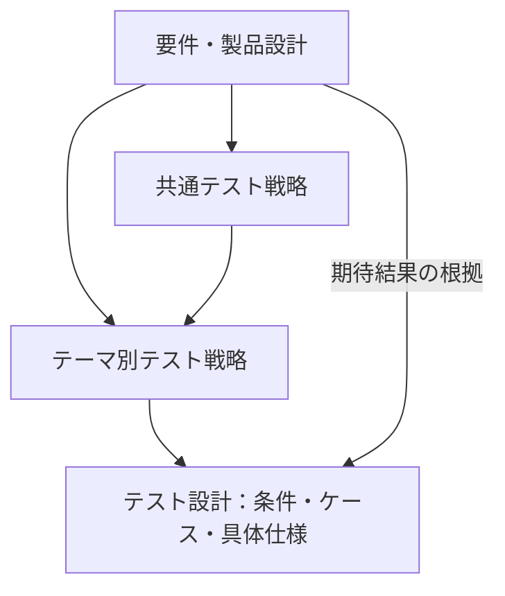

# DES-013：初期版の共通テスト戦略

- 設計状態：評価待ち。初期版全体の共通テスト戦略と文書設計への接続を整理する。上流反映・評価条件・観測契約の残件があり、実行準備・製品試験は未完了。残件の担当・解消条件・進行範囲は本文の未決事項・引継ぎに従い、必要な確認後にドラフトへ戻して再レビューする。
- 戦略区分：共通。上位戦略はなし。テーマ別戦略は本書を具体化し、矛盾は本書へ確認を返す。
- 目的・範囲：REQ-001～039の受入条件、依存する製品設計・IPC契約、方式の小規模成立確認を対象とする。条件・ケース・データ仕様・環境要件・準備・操作・後片付けは設計担当のテスト設計本文を正本とする。実データ生成・環境構築・コード化・実行計画・実行・製品結果評価は後続担当へ渡し、実行計画と結果は`docs/product-verification/`で管理する。本書は合否基準を追加・緩和しない。
- 入力確認日：2026-10-13。確認時点の入力は[REQ-029](../../product-requirements/non-functional-requirements/cross-cutting/REQ-029-image-and-project-limits.md)、[REQ-033](../../product-requirements/non-functional-requirements/cross-cutting/REQ-033-performance-evaluation-conditions.md)、[ADR-009](../architecture-decisions/2026-09-29-ADR-009-test-automation.md)、[編集状態](../functional-design/organization/DES-002-board-editing-state.md)の本文・該当節。現在の合意状況・設計状態は各本文を正本とし、方式の反映と成立確認を区別する。
- 参照要件：[要件一覧](../../product-requirements/index.md)のREQ-001～039。各本文・受入条件・状態を正本とし、過去の設計内の参照時点の状態から現在の合意を推定しない。特に[REQ-029](../../product-requirements/non-functional-requirements/cross-cutting/REQ-029-image-and-project-limits.md)と[REQ-033](../../product-requirements/non-functional-requirements/cross-cutting/REQ-033-performance-evaluation-conditions.md)の上限・共通条件を維持する。
- 関連判断：[ADR-009](../architecture-decisions/2026-09-29-ADR-009-test-automation.md)。実装時のテスト基盤採用と実行結果は別に扱う。

## 文書体系と判断の追跡

共通戦略は検証目的・横断リスク・層と基盤の分担原則・証拠・未決と完了判断を決める。テーマ別戦略はその原則を主要リスク、網羅方針、対象境界、観測・制御、他テーマとの分担へ具体化する。テスト設計は戦略に基づく分析からCONDを抽出し、CASEと具体仕様・手順へ展開する。

設計本文の「適用テスト戦略」と「戦略判断の具体化」を正本とし、通常のDES本文・見出しリンクで判断→COND群・共通仕様を追跡する。CASEへの追跡は既存COND→CASE対応を使う。テーマと設計は初期一対一、将来の分割では一対多を許容する。条件固有の技法・選定理由と要件・契約根拠、未決の詳細、共通データの管理元は既存設計に維持する。索引や戦略へ条件・ケースを複製しない。

## 検証目的・方針・主要リスク

利用者が画像を取り込み、俯瞰・細部を参照し、配置・グループ・メモを編集し、保存して後日または別PCで再開できることを受入条件から確認する。保存中の操作、障害時の直前成功内容、画像実体と復旧候補の保持を優先する。IPCは入出力・型・通知・順序・資源寿命の技術契約を確認し、その受付・中間結果を製品の操作成功へ置き換えない。

- 正常／異常は機能受入条件の区分を維持する。境界値、同値分割、決定表、状態遷移は技法として別に記載し、回復は異常へ含める。品質観点で正常／異常を適用しない場合は理由を条件本文に記載する。
- 受入条件・DES契約→条件→ケースの対応は各テスト設計本文で管理する。条件・ケースは文書内IDと見出しで識別し、工程索引にはDES一覧とREQ対応だけを置く。上流REQへケースIDや逆向き参照を追加しない。
- 原本入力、候補B0、再開調整後B1、固定保存対象、保存中の追加入力を区別する。期待結果は要件または明記した技術契約から導き、現行実装の挙動・テストダブル・画面通知だけを正解にしない。
- 共通データ仕様・環境・手順と保護対象の主ケースを一か所に置き、他テーマは参照と差分で接続する。同じ目的を全層へ複製せず、内部不変条件、実物の依存、利用経路の目的が異なる場合に分担する。

## 層別の確認目的

| 確認層・基盤 | 対象と根拠 | 依存の制御・観測 | 分担理由・必要な証拠 |
| --- | --- | --- | --- |
| ユニット：Vitest／Rust標準テスト | [編集状態](../functional-design/organization/DES-002-board-editing-state.md)、[ボードデータ](../data-design/DES-004-board-data-model.md)、[取込](../functional-design/collection/DES-010-image-import-pipeline.md)、[共通IPC](../interface/DES-014-ipc-common-protocol.md)の計数・値域・更新単位・集約・状態遷移 | 時計、入力、変換・ファイル操作の結果、Worker応答、通知順序を差し替える。前後の状態、ボードとアプリ寿命の独立更新番号、履歴、所有集合、エラー分類を比較する | 境界・規則・遷移を決定的に再現する。テストダブルでWindowsファイル操作・実描画・実IPCの成立を証明しない |
| インテグレーション：Rust標準テスト／フロントエンド結合 | [保存データ](../data-design/DES-008-project-file-data.md)、[保存・復旧](../functional-design/cross-cutting/DES-009-project-persistence-recovery.md)、[IPC定義元](../interface/DES-011-ipc-contracts.md)、[画像作業領域](../functional-design/cross-cutting/DES-046-image-workspace-management.md) | 実SQLite・PNG・ZIP・変換エンジン・Windowsファイル操作と使い捨て領域を組み合わせる。処理段階の停止・失敗、現物ハッシュ、記録、ロック、書出量を観測する。フロントエンド内のIPCモック確認と実Tauri転送を区別する | 構造・参照・部分失敗・保存順序・取消後結果を実物の依存で照合する。段階・入力・結果・前後ハッシュ・保存記録・資源所有を証拠にする |
| E2E：WebdriverIO＋外部tauri-driver＋Edge WebDriver／実機操作 | [ボード画面](../screen-design/DES-006-board-screen.md)、[保存画面](../screen-design/DES-007-persistence-screen.md)、[配布](../non-functional-design/cross-cutting/DES-012-portable-runtime-distribution.md)と主要受入経路 | 実Tauri・固定WebView2で起動、入力、画面状態、保存・再読込を観測する。Canvasは座標操作とモデル・実表示・保存結果を照合する。外部ブラウザ、OSダイアログ、IME、前面表示、配布、性能は実機確認手順も設計する | 全経路の組合せと実環境での成立を確認する。ビルド・環境・入力・操作・状態・画像・ファイル・時刻を証拠にし、自動化可能性は実証結果と分ける |

基盤の選定は[ADR-009](../architecture-decisions/2026-09-29-ADR-009-test-automation.md)を維持する。具体依存版・ドライバー整合・自動化の成立は後続準備で確認する。検証用ドライバーを利用者向け配布物に含めない。

## テスト種別・品質観点

| 種別・観点 | 対象・適用理由 | 確認層・観測と判定境界 |
| --- | --- | --- |
| 機能・操作性 | 取込、ボード、履歴、メモ、設定、再開・別PC、最小画面 | ユニットで値域・状態、E2E／実機で入力先・表示・到達性を照合する。メモ入力・IME・取消・未保存保護を含む |
| データ整合性・耐久・回復 | [保存整合性](../non-functional-design/cross-cutting/DES-041-save-integrity-and-recovery.md)と直前成功・復旧候補の保護 | インテグレーションで永続化段階の故障、E2Eで再起動・復旧選択・別名保存を確認する。DBコミット、本ファイル置換、復旧用更新、完了記録同期、表示通知を分ける |
| 容量・安全な入力 | [保存資源](../non-functional-design/cross-cutting/DES-040-project-resource-validation.md)、[変換資源](../non-functional-design/collection/DES-043-image-conversion-resource-controls.md)、[文字容量](../non-functional-design/organization/DES-045-note-text-capacity-controls.md) | 値域・上限の直前／一致／超過と、構造・参照・実出力量・メモ計数を確認する。上限内でも別の破損や資源不足で失敗し得る。不正候補を部分採用しない |
| 性能・表示資源 | REQ-021～026・033と[表示資源](../non-functional-design/cross-cutting/DES-042-rendering-performance-and-resources.md) | 実機E2Eの製品時間と、予約・同時数・CPU／GPU予算のDES技術確認を分ける。初期設計値を新しい製品受入基準へ昇格しない |
| 配布・互換性 | REQ-020、別PC・フォント差と[配布契約](../non-functional-design/cross-cutting/DES-012-portable-runtime-distribution.md) | 実配布物、一般利用者権限、同梱資材・実行パス、保存済みファイルの再開を確認する。未確定ビルド版や上流反映待ちを合格にしない |
| 通信・非同期・資源寿命 | 共通4契約、24コマンド、14通知 | ユニット／結合／実Tauriで包絡・順序・重複・照会・受領・所有・終結を確認する。技術契約の完了と製品の保存／表示／切替成功を区別する |

ネットワーク取得の失敗・不正な保存入力・所有違反は既存契約の範囲で扱う。新しいセキュリティ認証、互換性保証、未保存内容や停電・媒体故障の復元保証を追加しない。

## 観測可能性と依存の扱い

観測記録には対象ビルド・依存版・OS・入力識別、操作・制御した障害、要求／セッション／プロジェクト／イベント／スナップショット／トランザクションの識別子とボードとアプリ寿命の独立更新番号、保護対象の前後状態、現物ハッシュ、処理段階・時刻を関連付ける。画面表示だけでは保存完了や画像実体の保持を判定しない。

後続担当へ、制御時計、要求・通知の遅延／欠落／再掲、Worker失敗、保存固定前後・各永続化段階・候補採用直前の待機点、資源予約・参照所有の観測、実表示完了の計測仕様を渡す。現時点で観測フックが実装済みとは扱わない。必要な観測・制御を実現できなければ該当製品設計へ返し、ケースを推測で合格可能にしない。

使い捨て領域と原本の複製で障害を再現する。終端・所有・保護コピーを確認して証拠を回収し、障害制御を解除してから後片付けする。唯一の正常コピー、帰属不明の記録、進行中保存の所有を一括削除しない。

## テーマ別戦略との接続と責務

テーマ戦略へ本書の原則を渡し、確定した判断を配下設計の条件・具体仕様へ接続する。層・網羅・観測の詳細はテーマ戦略、条件・ケース・データ・環境・手順は設計本文を正本とする。全REQとDESの一覧対応は[設計一覧](../index.md)で管理する。

| テーマ別戦略 | 配下の設計 | 責務と共通仕様の境界 |
| --- | --- | --- |
| [DES-055：画像取込・変換](DES-055-image-import-test-strategy.md) | [DES-047](../test-design/DES-047-image-import-test-design.md) | 入力経路・形式、部分成功、取得・変換・配置・表示を分離。画像入力は047、境界数値は052、実体保護は050。 |
| [DES-056：ボード表示・編集・メモ](DES-056-board-interaction-test-strategy.md) | [DES-048](../test-design/DES-048-board-interaction-test-design.md) | 幾何・履歴・入力先、IME、文字容量と実描画。ボード・メモ・座標は048、保存・フォント調整は049。 |
| [DES-057：保存・設定・再開](DES-057-persistence-workflow-test-strategy.md) | [DES-049](../test-design/DES-049-persistence-workflow-test-design.md) | 保存対象固定、設定分離、ゲート、別PC・フォント・排他。保存状態・番号・設定・フォント差は049。 |
| [DES-058：保存整合性・障害復旧](DES-058-save-integrity-recovery-test-strategy.md) | [DES-050](../test-design/DES-050-save-integrity-recovery-test-design.md) | 保存未開始・途中・成功後、正常コピー・記録・画像実体を保護。物理成功と実体保護は050。 |
| [DES-059：IPC契約](DES-059-ipc-contract-test-strategy.md) | [DES-051](../test-design/DES-051-ipc-contract-test-design.md) | 共通4契約・24コマンド・14通知の型・順序・照会・受領・所有・寿命。通信終結から製品結果を推定しない。 |
| [DES-060：容量・安全な読込・表示資源](DES-060-resource-validation-test-strategy.md) | [DES-052](../test-design/DES-052-resource-validation-test-design.md) | 境界値、候補全体検証、予約・取消・解放。数値は052、取込元実検査は047、実体保護は050。 |
| [DES-061：性能](DES-061-performance-test-strategy.md) | [DES-053](../test-design/DES-053-performance-test-design.md) | 実機・実負荷、通常・自動保存中・手動保存中、実表示終点。REQ-033と各3回全回合格、未決U1～U4を維持。 |
| [DES-062：ポータブル配布](DES-062-portable-distribution-test-strategy.md) | [DES-054](../test-design/DES-054-portable-distribution-test-design.md) | 一般利用者権限、同梱依存、実行パス、主要経路と更新時保護。詳細操作は各主設計、配布台帳は054。 |

方式を左右する小規模成立確認はテーマ戦略の優先境界へ整理する。実装担当が試作・コード・観測手段、検証担当が実データ・環境・具体的実行計画・試験記録を担当し、成立しない方式は証拠と変更影響を基に製品設計・ADRへ返す。文書形式の検査から製品成立・性能を推定しない。

## 要件差分と判断の引継ぎ

| 対象要件 | 今回の決定・照合結果 | 反映・受入確認の担当と時期 |
| --- | --- | --- |
| REQ-001～003 | 既存のブラウザ範囲・6形式・部分成功を維持。ドラッグURLの自動取得と壊れたICCの個別失敗を具体化 | 要件担当がDES-010の変更案を実装引継ぎ前に本文・正常異常の受入条件へ照合・反映 |
| REQ-004・006～010・027 | 初期長辺320・グリッド・既存要素回避、中ボタンパン、キー割当て、メモ入力優先を具体化。既存Undo対象を拡張しない | 要件担当がDES-006とDES-010を照合。文章入力／IME中のキー競合と配置取消を受入条件へ反映 |
| REQ-010・031 | textarea併用を関連する判断記録に記載済みとして記録。フォント・折返し・文字数計数の技術方式を具体化し、既存保存境界・フォント差保護を維持 | 要件担当がDES-002・006の変更後本文をレビュー。実機品質は実装・検証担当 |
| REQ-011～019・023～025・029・032 | rusqlite・zip、非同期実行・番号精度に加え、24コマンドの供給・採用・ゲート・照会・寿命を具体化。DB外PNG、保存直列化、復旧・排他と全体検証は既存契約を維持 | 要件担当が期待結果を照合。実装・検証担当がDES-008・009・011の境界を実証 |
| REQ-020 | Home・x64・サポート中通常リリース・常時固定WebView2という配布方針で未決範囲を具体化 | 要件担当がDES-012の内容を本文・受入条件へ反映。全REQの合意へ自動遷移しない |
| REQ-021～026・033 | 性能目標・全3回・500枚共通条件は維持。固定データ・操作・計測点を準備する担当を明示 | 検証担当が受入前に再現可能な台帳・具体的試験計画を用意する |

ダーク固定はユーザーの画面方針としてDES-005へ記録し、テーマ設定機能を増やさない。画像エンジン、保存ライブラリ、配布とIPC方式の重要判断はADR-013～016に記録する。上流のPDR・要求・要件への本文反映は各担当へ引き継ぎ、設計側で合意状態を一括変更しない。

## 未決事項・後続準備・引継ぎ

| 区分・対象 | 影響する判定・進められる範囲 | 担当役割・確定時期・解消条件 |
| --- | --- | --- |
| 未決：性能の固定画像情報・固定ボード・操作・計測方法 | [REQ-033](../../product-requirements/non-functional-requirements/cross-cutting/REQ-033-performance-evaluation-conditions.md#性能の共通評価条件)の未決を維持する。既定の負荷・始点終点・閾値・各3回全回合格によるケースを設計し、未決に依存する完全な受入判定・引継ぎ可能判断を保留する | 設計・検証担当が実利用・試作と既定条件を照合し、検証計画時～受入前に固定情報・操作・保存中検出・実表示完了判定を確定する。必要な合意・上流反映と影響ケースの再レビュー後に受入判定へ進む |
| 未決：要求記録除去後の使用済みrequestId・所有者情報の保持終了条件 | [DES-014の要求記録](../interface/DES-014-ipc-common-protocol.md#要求記録と結果受領)に従う記録保持中の拒否・旧セッション照会、除去後notFound、専用資源終結は設計する。記録除去後のID再使用・初期化結果再取得・別所有者照合をいつまで保証するか、セッション／WebView終了・Rust再起動をまたぐ扱いは補作しない | 製品設計担当が保持情報と終了条件を明文化し、当該寿命に依存するケース確定前に共通IPC契約を整合させる。観測方法と影響ケースを再レビューする。保存中断記録・正常コピーの既存保護契約は独立して進める |
| 部分判定の残件：色・描画・入力操作の確認方法 | [DES-047](../test-design/DES-047-image-import-test-design.md#レビュー引継ぎ)の異なるICC数値比較・縮小透過輪郭、[DES-048](../test-design/DES-048-board-interaction-test-design.md#レビュー引継ぎ)の編集中変更手段・極端配置描画、[DES-049](../test-design/DES-049-persistence-workflow-test-design.md#レビュー引継ぎ)の未確定入力解消UI・取消時番号契約の解釈差は各本文の影響ケースに限定する。固定sRGB属性、モデル値域、確定履歴、保存固定など独立した判定を進める | 製品設計・実装・検証担当が該当操作や独立比較・観測方法を確定し、対象部分の実装引継ぎ／受入前に再レビューする。任意の色差・座標誤差許容値や専用操作を補作しない。実フォント対など仕様確定済みの実資料未作成は後続準備として扱う |
| 上流反映・レビュー待ち：URL取得・ICC・初期配置・キー・配布範囲等 | 本書の要件差分表と各DESの引継ぎを維持する。REQ受入とDES技術契約を分けて設計し、ドラフトのケース作成から全要件合意を推定しない | 要件担当が該当REQの本文・受入条件・現在状態を照合する。最終受入判定前に必要な反映と明示的合意を確認する。DES-006の確定キーとDES-007のCtrl+S候補表記の差は製品設計担当へ同期を返す |
| 観測・制御の設計確認：保存段階・要求欠落・実表示・所有・資源 | 既存の観測フックを前提にしない。ケースに必要な状態・段階・障害制御仕様を記載する。実現不能な観測境界に依存する範囲は未確認とする | 実装担当が内部観測・テストダブル・実Tauri／実機の実現方法を準備し、検証担当が同じ判定対象を観測できることを確認する。公開IPC追加・新しい製品合否値を無断で追加せず、不能時は製品設計へ返す |
| 後続準備未完了：具体ビルド・依存版・実データ・実機・コード | 固定画像・破損／大容量入力、原本複製、OS／ブラウザ／IME／ドライバー、配布物と障害制御の実体を準備する。仕様が確定している範囲の文書完成と、物の準備未完了を分ける | 実装担当は製品／テストコード・観測手段・固定依存ビルド、検証担当は実データ・環境・実行計画・証拠を準備する。実行前に台帳とケース仕様を照合し、実行結果は検証側の保存先で管理する |

期待する返却結果は対象文書・条件／ケース、ビルド・環境・入力・操作・結果・証拠、未決の解消内容、再確認対象である。役割宛ての引継ぎであり、架空の担当名・実行結果・成立確認を追加しない。受領後は契約・評価条件・ケースへの変更影響を確認して該当範囲を再レビューし、結果の受領だけで未決を解消済みにしない。

## 文書レビューの完了条件と残件

設計一覧と全対象REQの対応、本文・図・ADR・型・保存対象の整合、OKFメタデータと厳格リンク、未決事項の担当・時期・解消条件を確認する。テスト設計本文では根拠→条件→ケース、入力・環境・準備・操作・期待結果・観測・後片付け、主ケースと共通定義への参照を確認する。未対応・対象外・延期・未決は理由と影響を識別し、根拠のない網羅率・ケース数で完成判断しない。

根拠・再現方法・判定方法が揃い、判定を左右する未決が解消した範囲だけテスト設計を実装引継ぎ可能とする。実データ・環境・コードが未作成でも仕様確定済みの文書設計はレビューできる。全ケース完成を全製品DESの共通条件にせず、各製品設計の方式成立・必要な上流反映・合意・実証待ちを維持する。文書設計完成・実行準備完了・REQ合意・ADR採用・製品試験合格は別に判断する。

DES-011と分割先DES-014～039の通信契約の選択・物理名・型は決定済み。現在の残件は、要求記録除去後の識別情報の保持終了条件、要件本文への差分反映と変更後レビュー、固定する具体的依存ビルドと配布台帳、Windows実機の入力／描画／配布成立確認、性能の評価条件と性能・障害の実証である。方式の選択を未回答として再質問する必要はない。具体的な試験計画と結果を本書に架空で追加しない。

## 文書レビュー・引継ぎ範囲

確認日：2026-10-13。従前の機能・品質・IPCの3名による分担・相互レビューで、全39要件の受入条件と共通4契約・24コマンド・14通知の根拠→条件→ケースを照合した。テーマ固有の所見と部分判定の残件は各設計本文で管理する。親がID、必須記載、COND↔CASE、多対多対応、共通定義、索引を統合した。既存8設計の107条件・208ケースは未決を含む定義数であり、実行数・合格数・引継ぎ可能数ではない。

今回の再構成は共通1本文・テーマ別8本文・設計8本文とその作成規則を対象とする。重要な判断の具体化先、継承する原則、他テーマとの責務・未決管理元、改名・見出し移動の参照を相互レビューした。

| レビュー担当 | 今回確認した範囲と方法 | 結果 |
| --- | --- | --- |
| IPC担当→機能テーマ | DES-055～057の全章、047～049の判断対応、全37CONDと既存CASE・共通仕様への接続を照合 | 重要判断の反映漏れ、新しい製品合否、保存固定・B0/B1・取消後着・参照保護の境界矛盾なし |
| 機能担当→品質テーマ | DES-058・060～062全章、050・052～054の判断対応、全37CONDの根拠・CASE接続、053の共通負荷・始点終点・閾値・試行・未決を照合 | 重大な反映漏れ、根拠のない判断追加なし。既存CASE全数の再全文レビューとは区別する |
| 品質担当→IPC・共通戦略 | DES-059全章と051の判断対応、保存・寿命の影響条件と代表ケース、共通013の責務・正本・完了判断を照合 | 通信欠落と実保存ブロック、技術契約と性能、識別寿命未決と準備不足の区分が整合。追加指摘なし |

更新した4スキルの入口・手順・適用規則を使い、戦略だけ・ケースだけ・共通戦略変更・局所CASE変更の模擬依頼を読み取りで評価した。対象操作だけの選択、戦略判断→条件群・共通仕様→CASEによる変更影響、必要な範囲だけの差戻しを確認し、追加の規則矛盾は見つからなかった。模擬成果物・製品試験は作成・実行していない。

親の統合確認では、全39要件の対応とIPC共通4契約・24コマンド・14通知の既存根拠対応を維持し、8設計の判断対応表77行から全107CONDへ接続した。全107条件・208ケースの315節は変更前のSHA-256と全数一致し、ID・根拠・具体的期待結果を保持した。DES-013の改名、IPC見出し参照27件のDES-059への付替え、索引とメタデータの同期、旧パス参照0件を確認した。

文書検査は専用venvのPyYAML 6.0.3・markdown-it-py 4.0.0を確認して実施し、OKF v0.2の必須項目・厳格内部リンクは全181文書でエラー0・警告0。変更4スキルの形式検査、既存内部参照271件、差分形式と新規本文の空白・競合記号検査も通過した。テンプレートの変数と成果物生成用の例示リンクは実在文書の参照検査から除外した。

性能のU1～U4、DES-051 CASE-056の識別台帳寿命、各本文の部分判定・上流同期の残件は維持する。REQ・ADR・製品設計の合意／評価状態は変更しない。文書設計の完成範囲、実行準備完了、試験合格は別に報告する。実行準備は未完了、製品試験は未実施であり、未決依存の最終判定を保留する。
